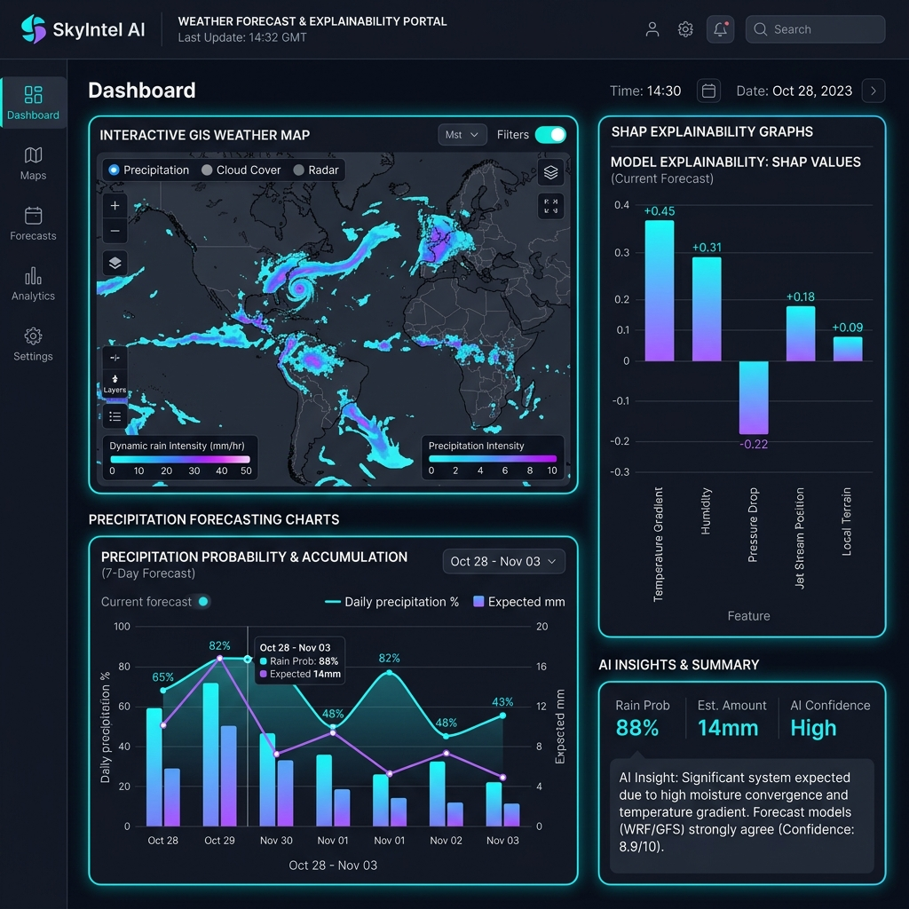

# <p align="center"></p>

# 🌧️ SkyIntel AI — Next-Generation Weather Intelligence & Explainable ML Platform

<p align="center">
  <a href="https://deva72199665-byte.github.io/SkyIntel-Ai/" target="_blank">
    
  </a>
  <a href="https://github.com/deva72199665-byte/SkyIntel-Ai" target="_blank">
    
  </a>
  
  
  
  
  
  
  
</p>

---

## 🌟 Platform Overview

**SkyIntel AI** is a state-of-the-art, enterprise-grade Weather Intelligence Platform designed to predict precipitation events, evaluate hydrological flood hazards, and model local micro-climate impacts. Built by **DSMV Labs**, the platform utilizes multi-model machine learning ensemble evaluation combined with TreeSHAP Explainable AI attribution to deliver clear, transparent, and actionable meteorology data.

This project is submitted as a formal Project Report for partial fulfillment of the **Diploma 3rd Year 5th Sem** course under **Dream Webies Academy of National Internship, Nanded** (Academic Year 2026–2027).

---

## 🚀 Key Features

*   🧠 **Multi-Model ML Ensemble:** Combines Random Forest, XGBoost, LightGBM, and CatBoost using soft-voting evaluation vectors to assess atmospheric inputs with extremely high accuracy.
*   🔍 **Explainable AI (XAI):** Uses SHAP (SHapley Additive exPlanations) to break down the "black box" of machine learning, visualizing the exact attribution force that parameters like temperature, humidity, and wind speed apply on the prediction.
*   🌐 **Digital Twin Weather Simulator:** Interactive telemetry sliders allow stakeholders to model extreme climate scenarios and observe immediate risk recalculations without server latency.
*   🗺️ **Interactive Weather Map (GIS):** Overlay real-time AQI, Wind Velocity, UV Index, and Rain warning telemetry on customized Leaflet Voyager map canvases.
*   📋 **Mission Intelligence Reports:** Automated PDF certificate exports containing observed telemetry, ML model choices, and automated lifestyle/agricultural advisories.
*   📊 **Personalized Analytics Dashboard:** Track and query local history logs, telemetry analytics graphs, and active municipal weather warnings.
*   🔐 **JWT Secure Access:** Fully integrated authentication middleware with encrypted user registration and token-based state persistence.
*   🚨 **Advisory Marquee Alerts:** Real-time administrative emergency broadcast banner pushed dynamically to standard users.

---

## 🖼️ User Interface Showcase

<p align="center">
  
  <br />
  <em>Interactive Weather Forecasting & Explainable AI Telemetry Controls</em>
</p>

---

## 🏗️ System Architecture

The following diagram illustrates how the frontend client interacts with the FastAPI backend, fetches live data, runs machine learning models, and computes Explainable AI attribution values:

```mermaid
graph TD
    A[Client Browser (React SPA)] -->|JWT Auth & REST API| B[FastAPI Gateway]
    B -->|Fetch Live API Data| C[OpenWeather API]
    B -->|Read/Write History & Users| D[SQLite Database via SQLAlchemy ORM]
    B -->|Predict & Explain| E[ML Prediction Engine]
    E -->|Voting Classifier Ensemble| F[Ensemble Models]
    F -->|Random Forest / XGBoost| G[Predictive Inference]
    F -->|LightGBM / CatBoost| G
    E -->|SHAP Explainer Matrix| H[Explainable AI Attribution]
    G -->|Result Array| B
    H -->|Attribution Force Map| B
```

---

## 🛠️ Technology Stack

| Layer | Technology | Primary Purpose | Key Features |
| :--- | :--- | :--- | :--- |
| **Backend** | Python 3.11 / FastAPI | Asynchronous RESTful API Gateway | Async microservices, automatic Swagger docs, high throughput |
| **Database** | SQLite + SQLAlchemy | Persisted Relational Data Store | Direct local storage, migration-ready ORM mapping, relational integrity |
| **ML Engine** | Scikit-Learn, XGBoost, LightGBM, CatBoost | Multi-model Voting Ensemble | Diverse algorithmic convergence, highly optimized predictive scoring |
| **Explainable AI** | SHAP (Shapley Additive exPlanations) | Black-box Prediction Interpretation | Feature-level force attribution, parameter contribution transparency |
| **Frontend** | React 18 / Vite | Single Page Application (SPA) | Fast Hot Module Replacement (HMR), component-driven UI, state management |
| **Styling** | TailwindCSS | Modern Utility-First UI Styling | Custom color palettes, fully responsive grids, premium typography |
| **Mapping** | Leaflet / React-Leaflet | GIS Geographic Overlay Map | Real-time weather radar tile overlay, interactive vector markers |
| **Charts** | Recharts | Interactive Telemetry Visualizations | Custom SVG charts, interactive tooltips, smooth animations |

---

## ⚙️ Installation & Setup

### Prerequisites
*   **Python 3.11** or higher
*   **Node.js 18+** (for frontend development/builds)
*   **Windows / macOS / Linux OS**

### 1. Initialize Virtual Environment & Install Dependencies
Navigate to the project root directory and run the following commands:

```bash
# Create a virtual environment
python -m venv .venv

# Activate the virtual environment
# On Windows (PowerShell):
.\.venv\Scripts\Activate.ps1
# On macOS/Linux:
source .venv/bin/activate

# Install backend requirements
pip install -r requirements.txt
```

### 2. Configure Environment Variables
Create a `.env` file in the root directory and configure the environment settings:

```env
APP_NAME="SkyIntel AI"
DATABASE_URL="sqlite:///./rain_predictor.db"
SECRET_KEY="replace-with-a-long-random-secret-key-of-at-least-32-chars"
ALGORITHM="HS256"
ACCESS_TOKEN_EXPIRE_MINUTES=60
OPENWEATHER_API_KEY="your_openweathermap_api_key_here"
```

### 3. Initialize Database Schema & Model Training
The FastAPI server will automatically initialize the database schema (`rain_predictor.db`) on startup. To train the models and initialize mock datasets, run:

```bash
python train_model.py
```

---

## 🏃 Running the Application

For ease of use in Windows environments, helper scripts are provided:

*   **Using PowerShell:**
    ```powershell
    .\run.ps1
    ```
*   **Using Batch Command Line:**
    ```cmd
    run.bat
    ```

Once started, the backend server will spin up on **`http://127.0.0.1:8000`** and serve both the FastAPI router and the precompiled React single-page frontend.

---

## 📂 Project Structure

```text
├── backend/
│   ├── api/             # API routes (auth, prediction, history, admin)
│   ├── core/            # Configuration and database settings
│   ├── models/          # SQLAlchemy Database Schema models
│   ├── schemas/         # Pydantic schema validation wrappers
│   ├── services/        # ML model loading and OpenWeather integration
│   └── main.py          # App entry point & static files middleware
├── frontend/
│   ├── src/
│   │   ├── components/  # Reusable widgets (Assistant, Map, Charts, Logo)
│   │   ├── pages/       # SPA Views (Dashboard, Prediction, Lab panel)
│   │   ├── utils/       # PDF and CSV export helper routines
│   │   └── main.jsx     # Frontend entry point
│   └── dist/            # Pre-compiled high-performance production assets
├── train_model.py       # ML Model training script
├── run.ps1/run.bat      # Windows bootstrapper run files
├── generate_50_page_pdf.py # Project report PDF generator compiler script
├── PROJECT_REPORT.pdf   # Generated 41-page PDF academic report file
├── PROJECT_REPORT.md    # Markdown copy of the project report chapters
└── rain_predictor.db    # Relational SQLite database
```

---

## 🔧 Recent Platform Fixes & Enhancements

*   🎨 **Logo SVG ID Scoping & Styling:** Enhanced the vector `Logo.jsx` component by introducing React `useId()` dynamic namespace scoping, preventing SVG linear gradient DOM collisions across multiple instances. Added a custom ambient glow backdrop, cloud contours, and telemetry crosshairs.
*   🔑 **Auth Token Persistence Repair:** Removed the `Clear-Site-Data` middleware header from backend response intercepts, resolving a redirect loop where `localStorage` tokens were cleared immediately after sign-in.
*   📑 **Academic Report Compilation:** Created a Python compiler (`generate_50_page_pdf.py`) utilizing **ReportLab** to compile a formal 41-page academic report with layout frames, index guides, ER structures, and embedded visual screenshots.

---

---

## 🌐 Live Deployment

| Service | URL | Platform |
|:--------|:----|:---------|
| **Frontend** | https://deva72199665-byte.github.io/SkyIntel-Ai/ | GitHub Pages |
| **Backend API** | https://skyintel-ai-backend.onrender.com | Render.com |
| **API Docs** | https://skyintel-ai-backend.onrender.com/docs | Swagger UI |

---

## 👥 Authors & Credits

SkyIntel AI was conceptualized and crafted by **DSMV Labs**:

*   💻 **Devidas Kulkarni** — Lead AI Architect & ML Engineer
*   🎨 **Sudhanwa Kulkarni** — Senior UI/UX Designer & Systems Architect
*   ⚡ **Mohammed Musaddiq** — Associate Frontend Specialist
*   🔧 **Vedant Rajegore** — Backend & Database Engineer

**Academic Guides:** Siddi Sir, Swapnil Sir, Samay Sir

---

## 📄 License

This project is developed for final-year engineering evaluation and commercial portfolio presentation. All rights reserved © 2026 **DSMV Labs**.
